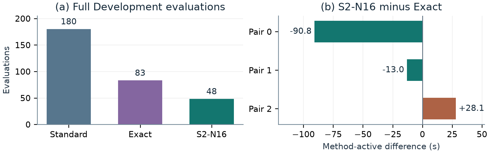
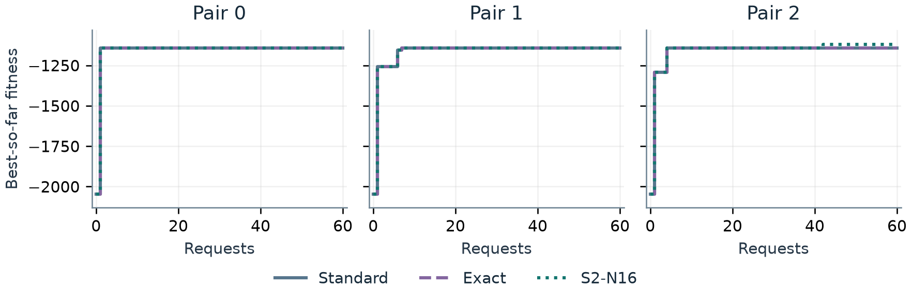

# Sample-Efficient FunSearch via Behavioral Fingerprinting for Online Bin Packing

*CS5491 Artificial Intelligence · Final research report draft*

## Abstract

FunSearch uses a language model to propose heuristic programs and an evaluator to select programs for future prompts. Different programs can make the same packing decisions, so full evaluation of every proposal may be wasteful. We compare Standard FunSearch, normalized exact-source filtering (Exact), and a stratified 16-state behavioral filter (S2-N16) in three matched sets of live searches. Each method receives 180 generation requests. S2-N16 completes 48 full Development evaluations versus 83 for Exact and 180 for Standard, a 42.2% reduction versus Exact. Its method-active time is lower than Exact in two matched pairs and higher in one. Final Development fitness ties in two pairs. In the third, S2-N16 improves the equal-family aggregate by using fewer Weibull bins while using more OR3 bins. The same trade-off appears on five frozen held-out instances with documented historical exposure. An independent audit of 18 sampled skip events finds two Development fitness mismatches, seven potential selected-island improvements, and zero skips above the recorded global-best threshold. These results support evaluation savings at the tested budget and show where finite behavioral matching can discard useful search feedback.

## 1. Introduction

Program search pays twice for many candidates: once to generate the program and again to run it on complete instances. Exact-source filtering catches repeated code after limited normalization. It cannot catch distinct expressions that choose the same bins on typical inputs. A short decision trace offers a cheaper test for suspected redundancy. Its value depends on how often a match saves work and whether skipping the program changes which heuristics enter the evolutionary database.

This project asks whether a finite behavioral filter reduces full evaluations at equal generation budgets, how that affects time and final packing quality, and what kinds of feedback the filter may lose. The evaluation follows the proposal's two-stage design. Fixed-pool replay examines filtering on identical inputs. Matched live search then measures complete policies with independently evolving databases. A separate audit re-evaluates a frozen sample of skips, and a held-out addendum evaluates the final Development-selected incumbents.

## 2. Background

FunSearch pairs LLM-generated function revisions with a trusted evaluator. Evaluated programs enter an island-structured database, and subsequent prompts draw on selected programs from that database [1, 2]. Each online bin-packing item arrives without knowledge of future items. The evaluator filters bins to those with sufficient remaining capacity, scores them with the candidate's `priority(item, bins)` function and chooses the first maximum. It opens a new bin when none fits. First Fit chooses the first feasible bin. Best Fit chooses the feasible bin with the least capacity remaining after placement. The objective is to minimize the number of bins used on the complete stream.

<!-- pagebreak -->

## 3. Behavioral fingerprinting

For a state s = (x, r, I), x is the item, r is the vector of feasible remaining capacities, and I contains the original bin indices. The fingerprint records one selected bin for each fixed probe state, using the same tie rule as full evaluation.

$$ dₕ(s) = I[first argmaxⱼ pₕ(x, r)ⱼ],   Φₙ(h) = (dₕ(s₁), …, dₕ(sₙ)). $$

All three methods share a static validity gate. Standard fully evaluates valid proposals. Exact first checks a normalized source key. The normalizer strips transport wrapping and normalizes the versioned function header while retaining substantive source text. S2-N16 first applies Exact, then checks for a repeated source with an already recorded behavioral skip (C1). Other candidates enter a disposable worker. On a valid vector match, the candidate is skipped and the evaluated representative remains in the database. On a miss, the same worker can continue to full evaluation. A recoverable fingerprint failure takes the F1 full-evaluation path. Only valid completed evaluations register programs. This policy skips candidate feedback as well as evaluation, so later prompts may diverge across methods.

S2 stratifies development-side feasible states across family and normalized item-size regions, with small feasible-bin sets and selection rules chosen to exercise varied decisions. A reserved development-side validation bank contains 256 states and is separate from the fingerprint bank. Matching fingerprints establish agreement on the chosen probes only. They can hide disagreements on other inputs and differences in packing fitness.

## 4. Experimental setup and controls

| Element | Frozen design |
| --- | --- |
| Live runs | Three matched pairs, three methods per pair, 60 requests per method and pair |
| Pair database seeds | 5491, 5492, 5493. Decoding seeds matched at each wave |
| Execution order | Serial rotation of Standard, Exact and S2-N16 within each pair |
| Generation | Qwen3.8 27B Q4_K_M, temperature 0.2, top-p 0.9, 512 output tokens |
| Packing inputs | Development: 12 OR3 [3] and 3 Weibull. Held-out: 4 OR3 and 1 Weibull |
| Worker | Pinned Linux Docker images, restricted process, one fresh worker per dispatch |

Each method starts with an independent copy of the same pair checkpoint. The prompt includes substantive evaluated feedback while excluding method-identifying receipt metadata. Shared seeds and rotating order control the initial comparison and timing order. Once a candidate registers in one run and is skipped in another, later prompts and generated programs may differ. The submitted proposal named Qwen2.5-Coder-7B-Instruct with a possible DeepSeek fallback. The completed main study used the fixed Qwen3.8 configuration above.

The protocol lists 51 known pilot calls, with an earlier connectivity count unavailable. The 540-call budget reported here covers the main study. The evaluator uses the following higher-is-better fitness, with 50% weight for each family regardless of instance count or stream length.

$$ F(h) = −½ [B̄_OR3(h) + B̄_Weibull(h)]. $$

<!-- pagebreak -->

## 5. Evaluation efficiency and timing

Fixed-pool replay compared fingerprint sizes 16, 64 and 128 on one frozen 16-request pool. The earlier separate-worker design took longer than its Exact control despite saving evaluations. The stratified S2 bank separated a known false match at all three sizes, and the three sizes had the same full-evaluation count in that pool. This replay supported taking N16 into the main study. Replay timing repetitions share candidate inputs and provide a distinct comparison from the live runs [4].

| Pair | Method | Full evaluations | Containers | Exact / behavioral / C1 skips | Active seconds |
| --- | --- | ---: | ---: | ---: | ---: |
| 0 | Standard | 60 | 60 | 0 / 0 / 0 | 654.803 |
| 0 | Exact | 27 | 27 | 33 / 0 / 0 | 597.506 |
| 0 | S2-N16 | 10 | 33 | 21 / 23 / 6 | 506.705 |
| 1 | Standard | 60 | 60 | 0 / 0 / 0 | 674.194 |
| 1 | Exact | 26 | 26 | 34 / 0 / 0 | 571.761 |
| 1 | S2-N16 | 18 | 29 | 26 / 11 / 5 | 558.712 |
| 2 | Standard | 60 | 60 | 0 / 0 / 0 | 665.394 |
| 2 | Exact | 30 | 30 | 30 / 0 / 0 | 580.951 |
| 2 | S2-N16 | 20 | 37 | 17 / 17 / 6 | 609.082 |

*Table 1. Each row contains 60 completed generation requests. A container may perform only a fingerprint, or both fingerprinting and full evaluation.*

S2-N16 used 48 full evaluations versus 83 for Exact and 180 for Standard. The reductions are (83 − 48)/83 = 42.2% and (180 − 48)/180 = 73.3%. S2-N16 saved 17, 8 and 10 full evaluations versus Exact in Pairs 0, 1 and 2. It also dispatched 99 containers and 99 fingerprints versus Exact's 83 containers and zero fingerprints. The 311 started full evaluations completed with valid coverage.

Method-active time sums method-owned generation and evaluation intervals, including readiness, reconstruction, filtering, worker lifecycle and registration. Human approval, shared orchestration, downtime and independent audit are outside that measure. S2-N16 minus Exact was −90.801, −13.049 and +28.131 seconds, a descriptive mean of −25.240 seconds. In Pair 2, S2-N16 saved 10 full evaluations while dispatching seven extra containers and taking more active time. Across S2-N16 runs, fingerprint compute occupied 0.102 seconds within a 5.524-second fingerprint phase. These nested measurements do not sum to total wall time. The methods' differing live generation and reconstruction costs also contribute to the contrasts.

<!-- pagebreak -->

## 6. Development search quality

| Pair | Method | Final fitness | OR3 mean bins | Weibull mean bins |
| --- | --- | ---: | ---: | ---: |
| 0 | All three methods | −1,142.542 | 212.417 | 2,072.667 |
| 1 | All three methods | −1,142.542 | 212.417 | 2,072.667 |
| 2 | Standard and Exact | −1,142.542 | 212.417 | 2,072.667 |
| 2 | S2-N16 | −1,119.625 | 225.583 | 2,013.667 |

*Table 2. Final incumbents after 60 requests in each run. Earlier Development First Fit and Best Fit anchors were −1,145.375 and −1,142.542 respectively.*

Final Development fitness tied in Pairs 0 and 1. In Pair 2, S2-N16 gained 22.917 fitness points versus both controls, with 13.167 more OR3 bins and 59.000 fewer Weibull bins per instance. The gain is an outcome of the tested live search trajectories. The experiment does not isolate which skip, registration or prompt change produced it.

## 7. Independent audit of behavioral skips

The audit selected six events per S2-N16 run by a frozen hash rank over 68 eligible direct behavioral or C1 skips. Eighteen sampled events required 24 distinct sources across skipped candidates and their representatives. Each distinct source received one full Development evaluation and one 256-state validation vector. The 48 audit workers completed in 112.635 seconds of audit-loop wall time. Audit results did not enter the search databases.

| Pair | Complete events | Fitness mismatches | Events with vector disagreement | Potential island gains | Above global best |
| --- | ---: | ---: | ---: | ---: | ---: |
| 0 | 6 | 0 | 0 | 4 | 0 |
| 1 | 6 | 1 | 0 | 2 | 0 |
| 2 | 6 | 1 | 1 | 1 | 0 |
| Total | 18 | 2 | 1 | 7 | 0 |

*Table 3. Positive opportunity margins use the threshold saved immediately before the skip and a numerical tolerance of 1e-9. The appendix lists all comparisons.*

<!-- pagebreak -->

## 7. Independent audit (continued)

Pair 1 candidate #129 scored 1.208 points above its representative #122 even though all 256 validation decisions agreed. Pair 2 candidate #166 scored 6.917 points below #139 and disagreed at validation positions 20 and 35. The other 16 events matched their representatives in both audited fitness and validation decisions. The seven potential island improvements include six events where the skipped program and its representative had equal measured fitness. Those representatives could have belonged to a different island with a different best threshold. A positive margin describes an opportunity at the selected island at that point in the recorded search. Descendant programs and alternative final outcomes were unobserved. No sampled skip exceeded the historical global best.

## 8. Frozen held-out evaluation

The addendum chose the highest-fitness registered Development incumbent for each run and broke ties by lowest island ID. The nine provenance rows resolved to eight exact source/body identities because Pair 0 Exact #61 and S2-N16 #121 shared their source. Each unique source was evaluated once under the same held-out input and evaluator contract. OR3 has four 500-item instances, and Weibull has one 5,000-item instance. The bin count for Weibull is therefore a single-instance count.

| Pair | Method | Candidate | Task | OR3 mean | OR3 total | Weibull bins | Fitness |
| --- | --- | ---: | ---: | ---: | ---: | ---: | ---: |
| 0 | Standard | 46 | 1 | 209.75 | 839 | 2,058 | −1,133.875 |
| 0 | Exact | 61 | 2 | 209.75 | 839 | 2,058 | −1,133.875 |
| 0 | S2-N16 | 121 | 2 | 209.75 | 839 | 2,058 | −1,133.875 |
| 1 | Standard | 59 | 3 | 209.75 | 839 | 2,058 | −1,133.875 |
| 1 | Exact | 93 | 4 | 209.75 | 839 | 2,058 | −1,133.875 |
| 1 | S2-N16 | 156 | 5 | 209.75 | 839 | 2,058 | −1,133.875 |
| 2 | Standard | 21 | 6 | 209.75 | 839 | 2,058 | −1,133.875 |
| 2 | Exact | 72 | 7 | 209.75 | 839 | 2,058 | −1,133.875 |
| 2 | S2-N16 | 162 | 8 | 224.00 | 896 | 2,000 | −1,112.000 |

*Table 4. Nine incumbent rows preserve eight independent worker measurements. OR3 totals are four times the recorded mean.*

Pairs 0 and 1 tie on both families. In Pair 2, S2-N16 uses 14.25 more OR3 bins per instance and 58 fewer Weibull bins. Its 21.875-point equal-family fitness advantage repeats the direction of the Development trade-off. Both tables should be read with the family weights in mind.

The first held-out attempt failed during worker imports and consumed one conservative evaluation charge. Recovery v1.1 stopped at the host guard before reservation. Recovery v1.2 completed all eight evaluations and verified cleanup. The cumulative research ledger is nine containers and nine conservative charges, with eight successful evaluations. A prior inert startup diagnostic used one separately accounted container. The audit and held-out stages used zero Qwen calls. The held-out stage used zero fingerprints.

<!-- pagebreak -->

## 9. Threats to validity

**Matched live trajectories.** Matching checkpoints, seeds and request counts controls the starting conditions. Independent registration can still change later proposals. Three matched comparisons on one machine and model provide descriptive evidence about these runs.

**Finite probes and audit sampling.** Agreement on 256 states can coexist with a fitness difference, as #129 demonstrates. The deterministic sample includes repeated sources, so its 18 events and 4,608 position comparisons provide descriptive evidence. Selected-island margins measure local opportunities whose downstream effects are unobserved.

**Held-out exposure and scale.** The retrospective split followed whole-OR3 baseline evaluation and legacy initialization of reference values. Four OR3 instances and one Weibull instance provide limited evidence for generalization. The original Weibull generation seed is unavailable. Incumbents were frozen from Development before the held-out comparison.

**Timing and implementation scope.** Total cost includes generation, Docker lifecycle, filtering and database operations. The replay uses one repeated pool. The live experiment compares the combined S2/C1/F1 policy, limiting attribution to individual features.

## 10. Conclusion

At 180 generation requests per method, S2-N16 avoided 35 full Development evaluations relative to Exact, saving full evaluations in all three matched pairs. Its active-time advantage varied by pair, and its quality advantage in Pair 2 came with an OR3–Weibull trade-off. The audit shows two concrete fitness mismatches and seven potential island-level gains hidden by the skip policy. Behavioral fingerprints are useful as a resource-saving heuristic whose impact depends on probe coverage, the search history and the cost of the execution environment.

## Reproducibility

The repository provides the filtering and trusted worker code, environment, input hashes, receipt-derived CSVs and offline checks. `REPRODUCIBILITY.md` distinguishes the verified analysis workflow from full runtime reproduction, which requires the original inputs, checkpoint, model, compatible isolation and fresh authorization.

## References

[1] B. Romera-Paredes et al. “Mathematical discoveries from program search with large language models.” *Nature*, 625, 468–475, 2024. [doi:10.1038/s41586-023-06924-6](https://doi.org/10.1038/s41586-023-06924-6).

[2] Google DeepMind. [FunSearch source repository](https://github.com/google-deepmind/funsearch). The local implementation derives from the fork identified in `NOTICE` at commit `4b8b4e7`.

[3] J. E. Beasley. [OR-Library: one-dimensional bin packing](https://people.brunel.ac.uk/~mastjjb/jeb/orlib/binpackinfo.html). OR3 source instance family.

[4] CS5491 project. [State Policy v2 fixed-pool comparison and archived project materials](https://github.com/PomeloRuii/CS5491-FunSearch-BinPacking/blob/45dd475d6d3aca2ea024f1c5104cbad98777538a/docs/STATE_POLICY_V2_RESULTS.md). The submitted proposal and completed study, audit and held-out reports form the local evidence record.

<!-- pagebreak -->

## Appendix. All 18 independent audit comparisons

Candidate and representative IDs are local to a pair. Δ fitness is the independently remeasured candidate fitness minus representative fitness. Global and island margins subtract the saved pre-skip threshold from candidate fitness. Positive island margins mark the seven potential opportunities. Validation differences are counts over 256 paired decisions per event.

| Pair / wave | Skip | Candidate → rep. | Island | Δ fitness | Vector diffs | Global margin | Island margin |
| --- | --- | --- | ---: | ---: | ---: | ---: | ---: |
| 0 / 37 | Direct | 157 → 121 | 1 | +0.000 | 0 | +0.000 | +1607.458 |
| 0 / 26 | C1 | 146 → 121 | 2 | +0.000 | 0 | +0.000 | +1607.458 |
| 0 / 33 | C1 | 153 → 127 | 9 | +0.000 | 0 | -1607.458 | +0.000 |
| 0 / 19 | Direct | 139 → 121 | 6 | +0.000 | 0 | +0.000 | +378.625 |
| 0 / 12 | Direct | 132 → 127 | 8 | +0.000 | 0 | -1607.458 | +0.000 |
| 0 / 34 | Direct | 154 → 121 | 5 | +0.000 | 0 | +0.000 | +1607.458 |
| 1 / 55 | C1 | 175 → 132 | 5 | +0.000 | 0 | -712.042 | +0.000 |
| 1 / 9 | Direct | 129 → 122 | 0 | +1.208 | 0 | -899.875 | +1.208 |
| 1 / 56 | Direct | 176 → 156 | 1 | +0.000 | 0 | +0.000 | +17.750 |
| 1 / 5 | Direct | 125 → 122 | 0 | +0.000 | 0 | -785.833 | +0.000 |
| 1 / 34 | C1 | 154 → 122 | 0 | +0.000 | 0 | -901.917 | +0.000 |
| 1 / 10 | Direct | 130 → 124 | 2 | +0.000 | 0 | -1606.625 | +0.000 |
| 2 / 46 | Direct | 166 → 139 | 7 | -6.917 | 2 | -134.917 | -6.917 |
| 2 / 12 | Direct | 132 → 123 | 3 | +0.000 | 0 | -1607.458 | +0.000 |
| 2 / 11 | Direct | 131 → 128 | 2 | +0.000 | 0 | -822.250 | -671.250 |
| 2 / 59 | Direct | 179 → 174 | 4 | +0.000 | 0 | -1131.917 | +0.000 |
| 2 / 13 | Direct | 133 → 123 | 4 | +0.000 | 0 | -1607.458 | +0.000 |
| 2 / 44 | C1 | 164 → 124 | 3 | +0.000 | 0 | -22.917 | +1607.458 |
