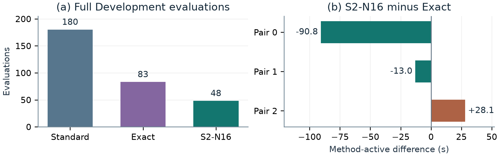
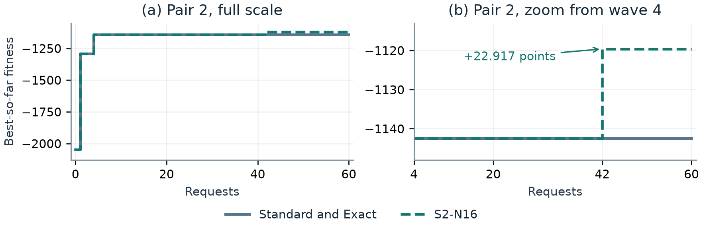

# Sample-Efficient FunSearch via Behavioral Fingerprinting for Online Bin Packing

*CS5491 Artificial Intelligence · Final Project · FunSearch Enhancements*

## Abstract

Full packing evaluations consume search time even when source-distinct heuristics make the same placement decisions. We use a fixed 16-state behavioral filter, S2-N16, to screen for this redundancy and compare it with Standard FunSearch and exact-source filtering in three matched live pairs. At 180 generation requests per method, S2-N16 completed 48 full evaluations versus 83 for Exact and 180 for Standard, a 42.2% reduction versus Exact. An audit of 18 skips found two fitness mismatches and seven potential selected-island gains. Development and held-out fitness tied in two pairs. In the third pair, S2-N16 achieved higher equal-family fitness on both splits, with fewer Weibull bins and more OR3 bins.

## 1. Motivation and background

FunSearch generates heuristic functions with an LLM, evaluates them, and uses an island database of selected programs to construct later prompts [1–3]. In online bin packing, items arrive sequentially and must be placed without seeing future items. The evaluator calls the candidate's `priority(item, bins)` on feasible residual capacities, selects the first maximum, and opens a new bin if none fits. The aim is to minimize bins used. First Fit and Best Fit provide packing baselines.

Different source programs can make the same decisions. We test whether a short decision trace reduces full evaluations at a matched generation budget, and track timing, search feedback and packing quality.

## 2. Fixed probes and processing policy

S2 collects feasible states along First Fit, Best Fit, Worst Fit and seeded random Development prefixes. It stratifies by family, four item-size bands cut at ¼, ½ and ¾ of capacity, and two layouts with an empty bin and either one occupied feasible bin or at least two distinct occupied residual capacities. Selection favors available exact fits and tied capacities, uses hash order to break ties, and redistributes empty strata. Rounds of 16 distinct states form fixed nested 16/64/128 banks. A separate Development-side construction provides 256 validation states [E1].

For state s = (x, r, I), x is the item, r the feasible capacities and I their original bin indices. The fingerprint records the selected index on each fixed probe using the evaluator's tie rule.

$$ dₕ(s) = I[first argmaxⱼ pₕ(x, r)ⱼ],   Φₙ(h) = (dₕ(s₁), …, dₕ(sₙ)). $$

After static checks, Standard fully evaluates candidates. Exact skips matching normalized source. S2-N16 applies Exact, then reuses a recorded behavioral skip for the same source (C1). Remaining candidates run the probes. A vector match marks a suspected duplicate of an evaluated representative. A miss proceeds to full evaluation, as does a recoverable probe failure (F1). Only complete valid results register. A matching vector establishes agreement on the selected probes and serves as a screening signal for full-stream behavior.

<!-- pagebreak -->

## 3. Fixed-pool replay and live controls

**Replay.** To compare probe sizes on a fixed pool, every replay arm received the same ordered 16-request candidate stream. In the state-policy replay, S2-16/64/128 each completed three full evaluations per block versus eight for Exact, retained the same best fitness, and separated the known #10/#8 false match that S0 missed. N16 was the smallest tested S2 bank to match the larger banks on this pool. The live study used N16 [E1].

**Live search.** To measure evaluation savings during live search, we used 60 requests per method in each of three matched pairs (540 main requests). Methods started from matched checkpoints with independent databases, paired decoding seeds and rotating serial order. Skips and registrations could change later prompts and candidates. Full evaluation used 12 OR3 and three Weibull Development instances [1, 4]. Fitness is higher-is-better, with 50% weight per family.

$$ F(h) = −½ [mean bins_OR3(h) + mean bins_Weibull(h)]. $$

The fixed generator was local Ollama Qwen3.8 27B Q4_K_M on an NVIDIA RTX 5090, with temperature 0.2, top-p 0.9, 512 output tokens, 32,768-token context and reasoning disabled. It replaced the proposed Qwen2.5-Coder-7B-Instruct. Recorded usage shows no DeepSeek fallback and $0 in external API charges. Hardware and electricity costs were unmetered.

## 4. Efficiency and timing

| Method | Requests | Full evals | Containers | Generation (s) | Evaluation (s) |
| --- | ---: | ---: | ---: | ---: | ---: |
| Standard | 180 | 180 | 180 | 978.605 | 1,015.787 |
| Exact | 180 | 83 | 83 | 986.405 | 763.814 |
| S2-N16 | 180 | 48 | 99 | 925.612 | 748.887 |

S2-N16 used 42.2% fewer full evaluations than Exact and 73.3% fewer than Standard. Against Exact, its method-active differences were −90.801, −13.049 and +28.131 s. In Pair 2, S2-N16 used ten fewer full evaluations and seven more containers than Exact. Generation plus evaluation time includes method-owned readiness, filtering, worker and registration costs. Human approval, shared orchestration, downtime and independent audit time are excluded.

<!-- pagebreak -->

## 5. Development packing quality

| Pair | Method | Final fitness | OR3 mean bins | Weibull mean bins |
| --- | --- | ---: | ---: | ---: |
| 0 | All methods | −1,142.542 | 212.417 | 2,072.667 |
| 1 | All methods | −1,142.542 | 212.417 | 2,072.667 |
| 2 | Standard and Exact | −1,142.542 | 212.417 | 2,072.667 |
| 2 | S2-N16 | −1,119.625 | 225.583 | 2,013.667 |

Pairs 0 and 1 tie. In Pair 2, S2-N16 uses 13.167 more OR3 bins and 59.000 fewer Weibull bins per instance than both controls. Its equal-family fitness improves by 22.917 points.

## 6. Independent audit of skips

To measure what the filter skipped, a frozen hash rank selected six direct behavioral or C1 skip events per pair from 68 eligible events. The 18 sampled events covered 24 distinct sources across candidates and representatives. Each received one independent full Development evaluation and a vector of 256 separate validation decisions. Opportunity margins compare the remeasured candidate with the historical pre-skip threshold, using a tolerance of 1e-9.

| Pair | Events | Fitness mismatches | Vector-mismatch events | Island opportunities | Above global best |
| --- | ---: | ---: | ---: | ---: | ---: |
| 0 | 6 | 0 | 0 | 4 | 0 |
| 1 | 6 | 1 | 0 | 2 | 0 |
| 2 | 6 | 1 | 1 | 1 | 0 |
| Total | 18 | 2 | 1 | 7 | 0 |

Pair 1 #129 scored 1.208 points above #122 despite agreeing on all 256 decisions. Pair 2 #166 scored 6.917 below #139 and differed at two validation positions. In six of the seven potential island improvements, the candidate and representative tied in fitness and both scored above the selected island's pre-skip best. The seven margins quantify potential improvements at the original skip events. The mismatch counts describe the 18 deterministically selected skip events, including repeated sources [E2].

<!-- pagebreak -->

## 7. Held-out packing quality

The held-out comparison uses each run's final Development incumbent, with ties broken by lowest island ID. Nine provenance rows map to eight measured source/body identities because Pair 0 Exact and S2-N16 share one source. The held-out split contains four 500-item OR3 instances and one 5,000-item Weibull instance.

| Pair | Method | OR3 mean bins | Weibull bins | Fitness |
| --- | --- | ---: | ---: | ---: |
| 0 | All methods | 209.75 | 2,058 | −1,133.875 |
| 1 | All methods | 209.75 | 2,058 | −1,133.875 |
| 2 | Standard and Exact | 209.75 | 2,058 | −1,133.875 |
| 2 | S2-N16 | 224.00 | 2,000 | −1,112.000 |

Pairs 0 and 1 tie. Pair 2 S2-N16 uses 14.25 more OR3 bins per instance and 58 fewer Weibull bins. Its equal-family fitness is 21.875 points higher. The direction repeats the Development trade-off. The 50/50 weighting gives one Weibull instance the same aggregate influence as the four OR3 instances together.

## 8. Research accounting and limitations

The proposal estimated approximately 570 requests (30 pilot plus 540 main). The known pre-main ledger reached 51: 30 earlier logged requests, three rejected V3 outputs, and 18 calls in the revised-prompt V4 pilot. The 540 matched main requests bring the documented total to 591 across these scopes. Earlier connectivity usage remains unquantified. Readiness preloads and infrastructure repairs are accounted separately.

Independent audit used 24 full and 24 validation workers, with zero model requests. The held-out ledger records eight completed evaluations and one additional startup charge. The supplement accounts separately for the zero-charge guard stop and inert diagnostic. The audit-event table, resource receipts and nine held-out rows are indexed in the repository supplement [E2].

The OR3 held-out split was designated retrospectively after historical whole-OR3 baseline evaluation and legacy reference-data initialization. The held-out comparison covers five instances. The live timing and search-quality comparisons cover three matched pairs on one host. The Pair 2 result compares complete live trajectories, each with its own search feedback and prompts.

## 9. Conclusion

At a matched generation budget, S2-N16 saved 35 full Development evaluations versus Exact. Final equal-family fitness tied in two pairs and was higher with S2-N16 in Pair 2 on both splits. A 16-state decision trace can screen source-distinct candidates before full packing evaluation.

<!-- pagebreak -->

## References

[1] B. Romera-Paredes, M. Barekatain, A. Novikov, M. Balog, M. P. Kumar, E. Dupont, F. J. R. Ruiz, J. S. Ellenberg, P. Wang, O. Fawzi, P. Kohli and A. Fawzi. “Mathematical discoveries from program search with large language models.” *Nature*, 625(7995), 468–475, 2024. [doi:10.1038/s41586-023-06924-6](https://doi.org/10.1038/s41586-023-06924-6).

[2] Google DeepMind. [FunSearch official source repository](https://github.com/google-deepmind/funsearch), online bin-packing evaluator and program search implementation. Apache-2.0 software license.

[3] RayZhhh. [Course-linked FunSearch bin-packing implementation](https://github.com/RayZhhh/funsearch/tree/4b8b4e7d43287998500983d709dfa44be58fca91), commit `4b8b4e7d43287998500983d709dfa44be58fca91`. The repository NOTICE records the local source attribution.

[4] J. E. Beasley. [OR-Library: one-dimensional bin packing](https://people.brunel.ac.uk/~mastjjb/jeb/orlib/binpackinfo.html), `binpack3` uniform 500-item instances contributed by E. Falkenauer. Weibull benchmark methodology follows [1, 2].

**Project evidence (internal records and repository supplements)**

[E1] CS5491 State Policy v2, `docs/STATE_POLICY_V2_RESULTS.md`, `phase3/state_policy_v2/states.py` and `results/state_policy_v2/`. Frozen state construction, replay, and per-size measurements.

[E2] CS5491 completed study, independent audit and held-out archive. `paper/SUPPLEMENT.md` indexes the `results/main_study/` tables. The latter contains receipt-derived observations and provenance digests. `REPRODUCIBILITY.md` specifies offline checks and runtime limits.
